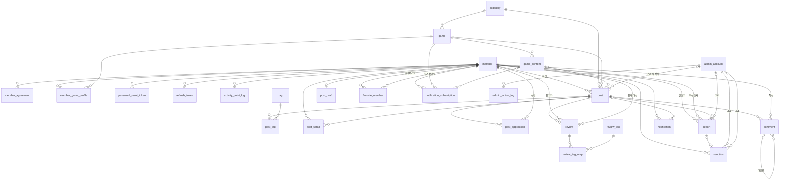
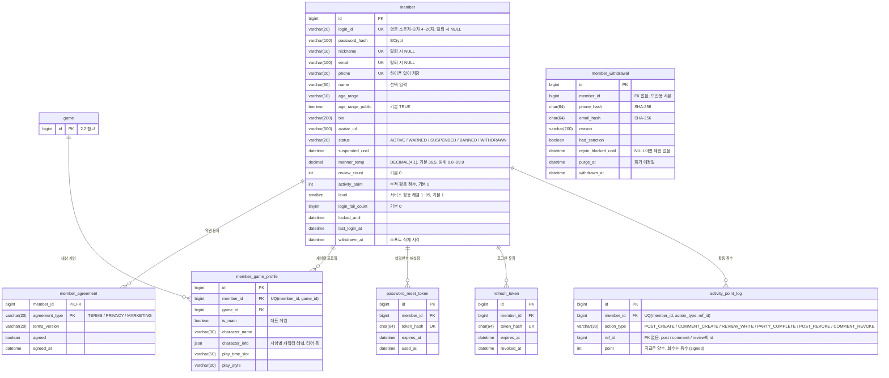
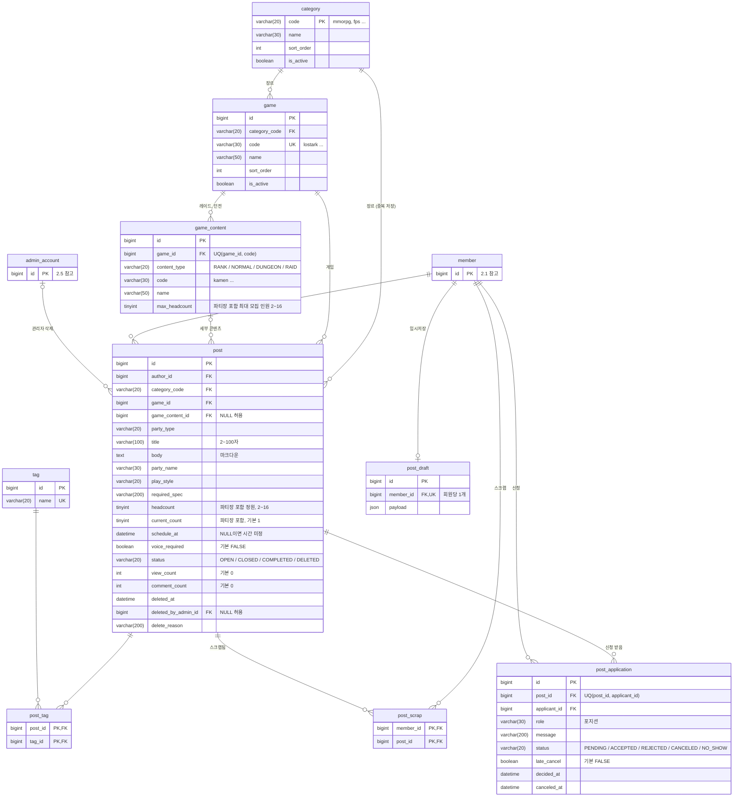
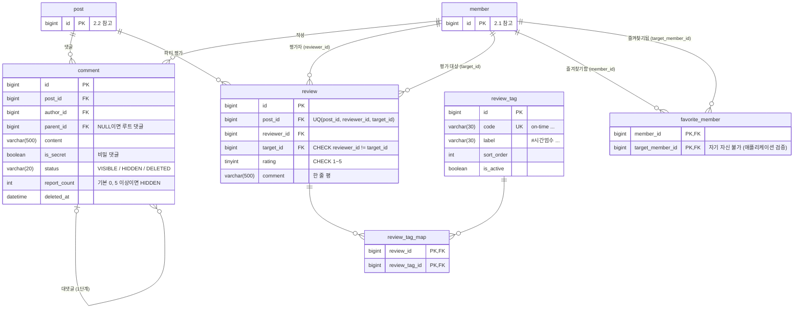
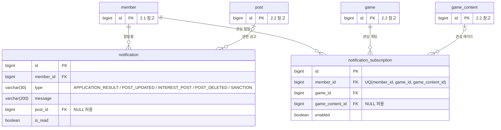
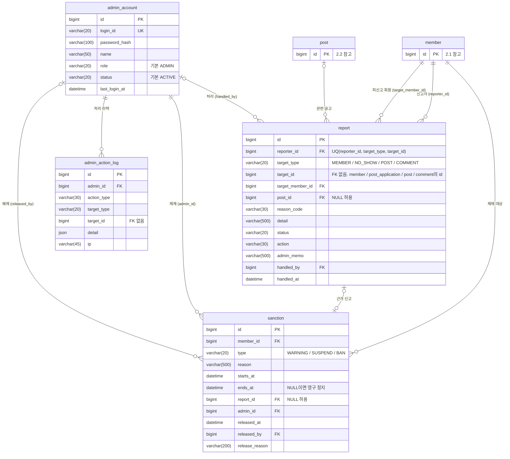

# ERD

[DB 설계안](./03-db-design.md)의 테이블과 관계를 ERD로 옮긴 문서입니다. 컬럼 길이·제약·인덱스의 근거는 03 문서에 있고, 이 문서는 **구조를 한눈에 보는 용도**입니다.
설계가 바뀌면 03 문서를 먼저 고치고 이 문서를 맞춰 주세요.

> GitHub와 VS Code(Markdown Preview Mermaid Support 확장)에서 다이어그램으로 렌더링됩니다.

## 표기법

| 표기 | 뜻 |
| --- | --- |
| `\|\|--o{` | 1 : 0..N (부모 1개에 자식 0개 이상) |
| `\|o--o{` | 0..1 : 0..N (자식의 FK가 NULL일 수 있음) |
| `\|\|--o\|` | 1 : 0..1 |
| `PK` / `FK` / `UK` | 기본키 / 외래키 / UNIQUE |

- `bigint`는 모두 `BIGINT UNSIGNED`, `int`·`smallint`·`tinyint`는 `UNSIGNED`입니다. 예외는 설명에 `signed`로 표시했습니다.
- 모든 테이블에 있는 공통 컬럼 `created_at`, `updated_at`은 다이어그램에서 생략했습니다.
- 다른 절에서 자세히 그린 테이블은 `id`만 적고 "참고"로 표시했습니다.
- 복합 UNIQUE, CHECK 제약은 Mermaid로 표현할 수 없어서 컬럼 설명에 적었습니다.

---

## 1. 전체 관계도

테이블 사이의 관계만 표시합니다. `member_withdrawal`(탈퇴자 보관)은 FK가 없는 독립 테이블이라 여기에는 나오지 않습니다.

---

## 2. 도메인별 ERD

### 2.1 회원 · 인증

### 2.2 마스터 · 공고 · 파티

### 2.3 댓글 · 평가 · 즐겨찾기

### 2.4 알림

### 2.5 신고 · 관리

---

## 3. FK 목록과 삭제 동작

03 문서 [3. 관계](./03-db-design.md#3-관계)의 ON DELETE 규칙을 FK 단위로 풀어 쓴 표입니다.
원칙은 세 가지입니다. 마스터 데이터(category·game·game_content·tag·review_tag)와 보존할 기록은 RESTRICT, 회원에게만 딸린 데이터는 CASCADE입니다. 알림의 공고 링크처럼 없어도 되는 참조는 SET NULL입니다.

| 자식 테이블.컬럼 | 부모 | 관계 | ON DELETE |
| --- | --- | --- | --- |
| member_agreement.member_id | member | 1:N | CASCADE |
| member_game_profile.member_id | member | 1:N | CASCADE |
| member_game_profile.game_id | game | 1:N | RESTRICT |
| password_reset_token.member_id | member | 1:N | CASCADE |
| refresh_token.member_id | member | 1:N | CASCADE |
| activity_point_log.member_id | member | 1:N | CASCADE |
| game.category_code | category | 1:N | RESTRICT |
| game_content.game_id | game | 1:N | RESTRICT |
| post.author_id | member | 1:N | RESTRICT |
| post.category_code | category | 1:N | RESTRICT |
| post.game_id | game | 1:N | RESTRICT |
| post.game_content_id | game_content | 0..1:N | RESTRICT |
| post.deleted_by_admin_id | admin_account | 0..1:N | RESTRICT |
| post_tag.post_id | post | 1:N | CASCADE |
| post_tag.tag_id | tag | 1:N | RESTRICT |
| post_draft.member_id | member | 1:0..1 | CASCADE |
| post_scrap.member_id | member | 1:N | CASCADE |
| post_scrap.post_id | post | 1:N | CASCADE |
| post_application.post_id | post | 1:N | RESTRICT |
| post_application.applicant_id | member | 1:N | RESTRICT |
| comment.post_id | post | 1:N | RESTRICT |
| comment.author_id | member | 1:N | RESTRICT |
| comment.parent_id | comment | 0..1:N | RESTRICT |
| review.post_id | post | 1:N | RESTRICT |
| review.reviewer_id | member | 1:N | RESTRICT |
| review.target_id | member | 1:N | RESTRICT |
| review_tag_map.review_id | review | 1:N | CASCADE |
| review_tag_map.review_tag_id | review_tag | 1:N | RESTRICT |
| favorite_member.member_id | member | 1:N | CASCADE |
| favorite_member.target_member_id | member | 1:N | CASCADE |
| notification.member_id | member | 1:N | CASCADE |
| notification.post_id | post | 0..1:N | SET NULL |
| notification_subscription.member_id | member | 1:N | CASCADE |
| notification_subscription.game_id | game | 1:N | RESTRICT |
| notification_subscription.game_content_id | game_content | 0..1:N | RESTRICT |
| report.reporter_id | member | 1:N | RESTRICT |
| report.target_member_id | member | 1:N | RESTRICT |
| report.post_id | post | 0..1:N | RESTRICT |
| report.handled_by | admin_account | 0..1:N | RESTRICT |
| sanction.member_id | member | 1:N | RESTRICT |
| sanction.report_id | report | 0..1:0..1 | SET NULL |
| sanction.admin_id | admin_account | 1:N | RESTRICT |
| sanction.released_by | admin_account | 0..1:N | RESTRICT |
| admin_action_log.admin_id | admin_account | 1:N | RESTRICT |

### FK를 걸지 않는 참조

| 컬럼 | 이유 |
| --- | --- |
| report.target_id | 대상이 회원·신청(노쇼)·공고·댓글 등 여러 테이블이라 하나의 FK로 걸 수 없습니다. 신고당한 회원은 target_member_id에 따로 저장합니다. |
| admin_action_log.target_id | 같은 이유. 이력은 대상이 지워져도 남아야 합니다. |
| activity_point_log.ref_id | 근거가 공고·댓글·리뷰 중 하나라 하나의 FK로 걸 수 없습니다. 근거 글이 삭제돼도 점수 이력은 남아야 합니다. |
| member_withdrawal.member_id | 보관용 사본이라 원본 회원 행과 독립적으로 파기 일정을 가져갑니다. |
