# 클래스 설계

OurParty 백엔드(`backend/src/`)의 클래스(모듈) 구조입니다. 요구사항([02](./02-requirements.md)) · DB([03](./03-db-design.md) · [04](./04-erd.md)) · API([API_SPEC](./API_SPEC.md))와 어떻게 이어지는지는 [6절 추적표](#6-요구사항--클래스--db--api-추적표)에 정리했습니다.

- 기준: 2026-11-17 `main` 코드. 다이어그램의 메서드 목록은 각 파일이 실제로 `return { … }` 하는 공개 함수와 같습니다.
- 계층 규칙과 네이밍은 [CODING_CONVENTION.md](./CODING_CONVENTION.md) 8절을 따릅니다.

## 0. 표기법

백엔드는 JavaScript(CommonJS)이며, 계층 객체를 `class` 대신 **팩토리 함수**로 만듭니다.

```js
function createMemberService({ memberRepository, tokenProvider, bcryptRounds, now }) { // ← 생성자 인자 = 의존성
  async function signup(input) { … }                                                     // ← 메서드
  return { checkAvailability, signup, login, … };                                         // ← 공개 메서드
}
```

| 다이어그램 표기 | 코드 |
| --- | --- |
| 클래스 이름 `MemberService` | 팩토리 함수 `createMemberService()` 가 돌려주는 객체 |
| 필드 `-memberRepository` | 팩토리 인자로 주입받는 의존성 (클로저에 보관) |
| 메서드 `+signup()` | 반환 객체에 담긴 공개 함수 |
| `A ..> B` (의존) | A 가 B 를 인자로 받아 호출 |

`class` 키워드로 만든 실제 클래스는 `ApiError`(백엔드)와 `ApiRequestError`(프론트엔드) 두 개입니다. 팩토리 방식을 쓰는 이유는 테스트에서 `createApp({ memberRepository: fake })` 처럼 repository 를 가짜로 바꿔 끼우기 쉽기 때문입니다.

## 1. 전체 구조

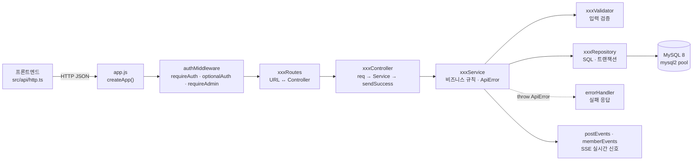

- 각 도메인 폴더의 `index.js` 가 `createXxxModule()` 에서 Repository → Service → Controller → Router 를 차례로 만들어 조립하고, `app.js` 가 라우터를 URL 에 마운트합니다.
- Service 와 Controller 는 `pool` 을 모릅니다. DB 접근은 Repository 만 합니다.

## 2. 공통 모듈 (`src/common/`, `src/config/`)

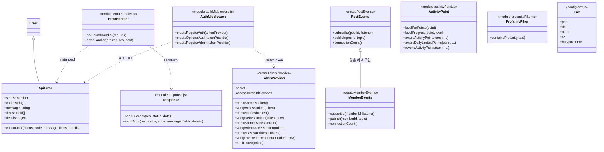

| 모듈 | 책임 |
| --- | --- |
| `ApiError` | 상태 코드·에러 코드·메시지를 담는 예외. Service·Validator 가 throw |
| `response.js` · `errorHandler.js` | API_SPEC 1절 응답 포맷 `{ success, data }` / `{ success, error }` 생성 |
| `tokenProvider.js` | JWT 발급·검증(회원 Access/Refresh, 관리자, 비밀번호 재설정), 토큰 SHA-256 해시 |
| `authMiddleware.js` | `Authorization: Bearer` 검사 후 `req.auth` 설정 |
| `postEvents.js` · `memberEvents.js` | 공고 상세·알림함 SSE 구독/발행 허브 |
| `activityPoint.js` | 활동 점수 지급·회수와 레벨 계산 (여러 도메인이 같은 트랜잭션 안에서 호출) |
| `profanityFilter.js` | 공고·댓글 욕설 검사 |
| `config/env.js` · `config/db.js` | 환경 변수 읽기, mysql2 커넥션 풀 (UTC) |

## 3. 도메인 모듈 한눈에 보기

| 도메인 (`src/…`) | Controller | Service | Repository | 그 밖의 파일 |
| --- | --- | --- | --- | --- |
| `member` 인증 | `MemberController` | `MemberService` | `MemberRepository` | Validator, Constants |
| `account` 내 계정 | `AccountController` | `AccountService` | `AccountRepository` | `AvatarStorage`, `R2AvatarStorage`, `avatarImage` |
| `mypage` 마이페이지·회원 프로필 | `MypageController` | `MypageService` | `MypageRepository` | Validator, Constants |
| `post` 공고 작성 | `PostController` | `PostService` | `PostRepository` | Validator, Constants |
| `board` 공고 조회·댓글·신고 | `BoardController`, `CommentController` | `BoardService`, `CommentService` | `BoardRepository`, `CommentRepository` | Validator, Constants (각 2개) |
| `party` 참가·초대·추방 | `PartyController` | `PartyService` | `PartyRepository` | Validator, Constants |
| `poll` 투표 | `PollController` | `PollService` | `PollRepository` | Validator, Constants |
| `review` 매너 평가 | `ReviewController` | `ReviewService` | `ReviewRepository` | `mannerTemp`, Validator, Constants |
| `ranking` 매너 랭킹 | `RankingController` | `RankingService` | `RankingRepository` | Validator, Constants |
| `notification` 알림 | `NotificationController` | `NotificationService` | `NotificationRepository` | Validator, Constants |
| `game` 게임 목록 | `GameController` | `GameService` | `GameRepository` | – |
| `category` 카테고리 | (`index.js` 가 직접 응답) | – | `CategoryRepository` | 조회 한 건뿐이라 Service 생략 |
| `admin` 관리자 | `AdminController` | `AdminService` | `AdminRepository` | Validator, Constants |

## 4. 도메인별 클래스 다이어그램

모든 Controller 는 Service 하나에, 모든 Service 는 Repository 하나에 의존합니다(`board` 는 두 쌍). 아래 다이어그램은 그 의존과 공개 메서드를 보여줍니다.

### 4.1 회원 인증 (`member`)

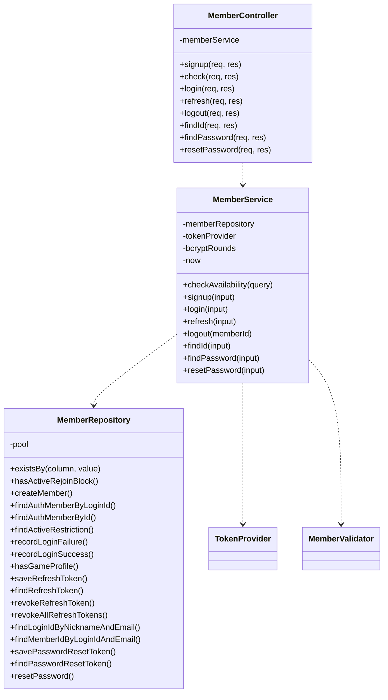

- 비밀번호는 `MemberService` 가 `bcrypt.hash` / `bcrypt.compare` 로 다루고, Repository 에는 해시만 넘깁니다.
- 테이블: `member`, `member_agreement`, `member_withdrawal`(재가입 제한 확인), `refresh_token`, `password_reset_token`

### 4.2 내 계정 (`account`)

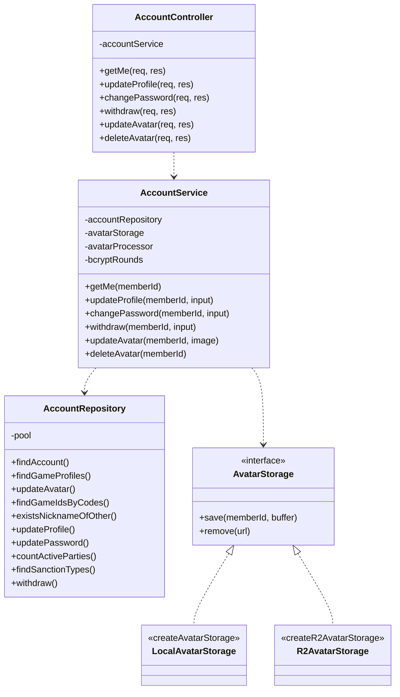

- 프로필 사진은 `avatarImage.processAvatar` 로 256×256 WEBP 로 바꾼 뒤 저장소에 넣습니다. R2 환경 변수가 모두 있으면 R2, 아니면 로컬 폴더를 씁니다(`createConfiguredAvatarStorage`).
- 테이블: `member`, `member_game_profile`, `member_withdrawal`, `refresh_token`, `sanction`

### 4.3 마이페이지 · 회원 프로필 (`mypage`)

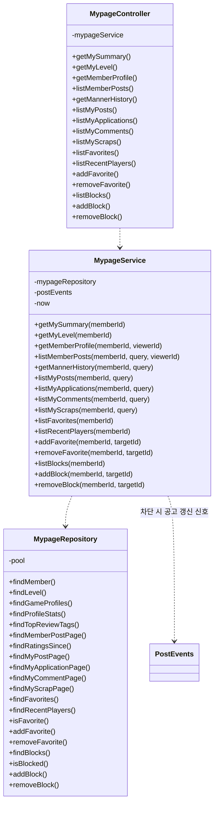

- 테이블: `member`, `member_game_profile`, `post`, `post_application`, `comment`, `post_scrap`, `favorite_member`, `member_block`, `review`, `review_tag_map`

### 4.4 공고 작성 (`post`)

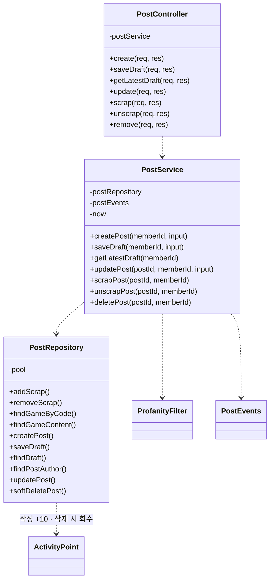

- 테이블: `post`, `post_tag`, `tag`, `post_draft`, `post_scrap`, `notification`(수정·삭제·관심/즐겨찾기 알림), `activity_point_log`

### 4.5 공고 조회 · 댓글 · 신고 (`board`)

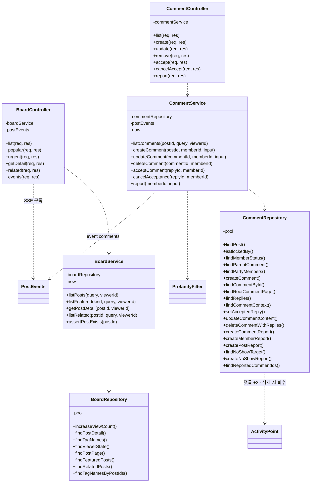

- 검색(`q`)·카테고리·태그·정렬·페이징은 `BoardRepository.findPostPage` 한 곳에서 처리합니다.
- 답글 채택(`acceptComment`)은 질문(댓글) 작성자만 할 수 있고, 결과는 `comment.accepted_reply_id` 에 저장합니다.
- 테이블: `post`, `post_tag`, `tag`, `post_scrap`, `post_application`, `comment`, `report`, `member_block`, `activity_point_log`

### 4.6 파티 참가 · 초대 · 추방 (`party`)

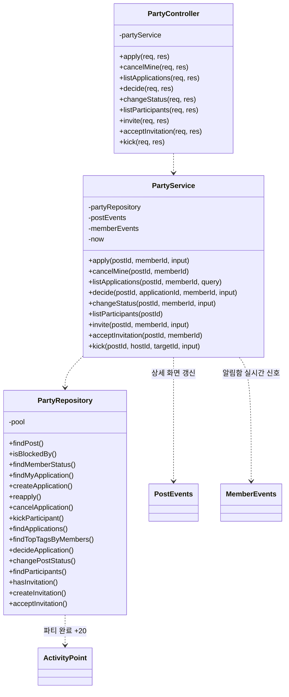

- 테이블: `post`, `post_application`, `notification`(신청·결과·취소·추방·초대 알림), `review_tag_map`, `member_block`, `activity_point_log`

### 4.7 투표 (`poll`)

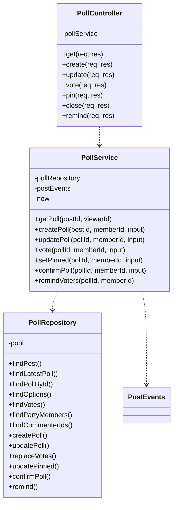

- 테이블: `poll`, `poll_option`, `poll_vote`, `post_application`, `comment`(확정 안내 댓글), `notification`

### 4.8 매너 평가 · 랭킹 (`review`, `ranking`)

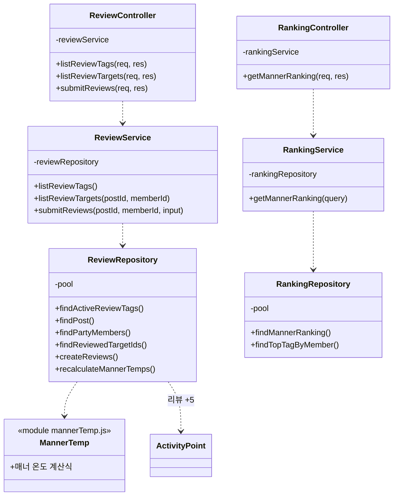

- 테이블: `review`, `review_tag`, `review_tag_map`, `member`(`manner_temp`, `review_count`), `post_application`, `activity_point_log`

### 4.9 알림 (`notification`)

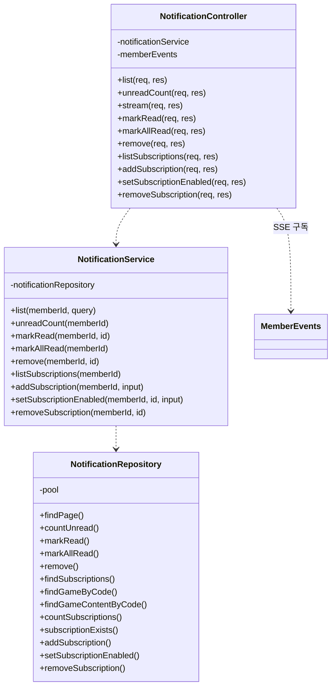

- 알림 행은 각 도메인(post · party · poll · admin)의 Repository 가 자기 트랜잭션 안에서 `notification` 에 바로 넣습니다. 이 모듈은 알림함 조회·읽음·삭제와 관심 알림 설정을 담당합니다.
- 테이블: `notification`, `notification_subscription`, `game`, `game_content`

### 4.10 마스터 데이터 (`game`, `category`)

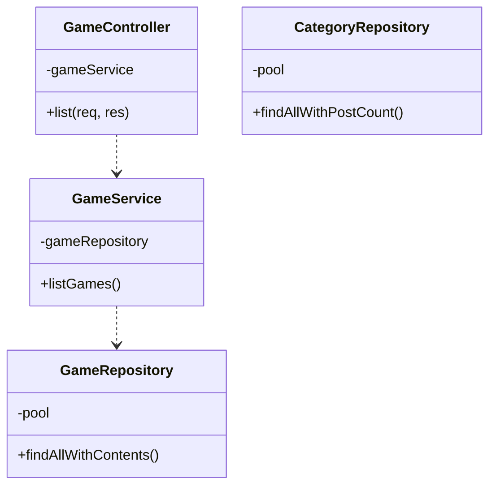

- `category` 는 조회 한 건뿐이라 `index.js` 의 핸들러가 `CategoryRepository` 를 바로 호출합니다.
- 테이블: `category`, `game`, `game_content`, `post`

### 4.11 관리자 (`admin`)

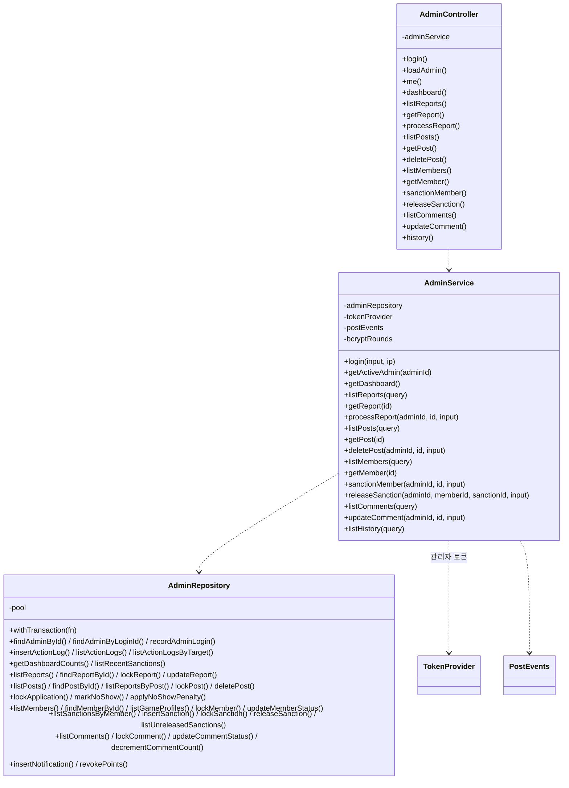

- `AdminRepository.withTransaction(fn)` 은 같은 메서드 묶음을 커넥션 하나로 다시 만들어 넘겨, 신고 처리·제재·삭제와 처리 이력 기록이 한 트랜잭션에서 함께 반영되게 합니다.
- 관리자 계정은 `admin_account` 로 회원과 분리되어 있고, 인증은 `requireAdmin`(관리자 토큰)으로만 통과합니다.
- 테이블: `admin_account`, `admin_action_log`, `report`, `sanction`, `member`, `post`, `comment`, `post_application`, `notification`, `activity_point_log`

## 5. 프론트엔드 연동 구조 (`frontend/src/`)

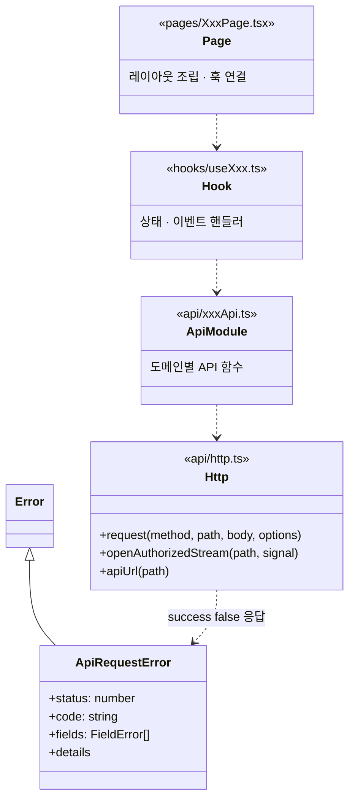

- 프론트의 `api/xxxApi.ts` 는 백엔드 도메인과 짝을 이룹니다 (`authApi` ↔ member, `accountApi` ↔ account, `boardApi`·`postDetailApi`·`commentApi` ↔ board, `postApi` ↔ post · party, `mypageApi` ↔ mypage · party(초대), `pollApi` ↔ poll, `reviewApi` ↔ review, `rankingApi` ↔ ranking, `notificationApi` ↔ notification, `gameApi` ↔ game, `adminApi` ↔ admin).

## 6. 요구사항 ↔ 클래스 ↔ DB ↔ API 추적표

| 요구사항 ([02](./02-requirements.md)) | 클래스 (Service) | 주요 테이블 ([03](./03-db-design.md)) | API ([API_SPEC](./API_SPEC.md)) |
| --- | --- | --- | --- |
| LOGIN-001~008, SIGNUP-001~005 | `MemberService` | `member`, `member_agreement`, `refresh_token`, `password_reset_token`, `member_withdrawal` | `/api/auth/*` (2절) |
| MYPAGE-003·004, PROFILE-001·002·004·007, WITHDRAW-001~004 | `AccountService` | `member`, `member_game_profile`, `member_withdrawal` | `/api/members/me` (GET·PATCH·DELETE), `/me/password`, `/me/avatar` (2절) |
| MYPAGE-001·005·006, PROFILE-003·005·006, FAV-002·003, BLOCK-001 | `MypageService` | `member`, `favorite_member`, `member_block`, `post_scrap`, `review` | `/api/members/me/*`, `/api/members/{memberId}` (8절) |
| POST-001~003·008~011, FAV-001, NOTI-004 | `PostService` | `post`, `post_tag`, `tag`, `post_draft`, `post_scrap`, `notification` | `POST·PUT·DELETE /api/posts`, `/drafts`, `/scrap` (3절) |
| POST-004~006·012, MAIN-006~009, BLOCK-002 | `BoardService` | `post`, `post_tag`, `member_block` | `GET /api/posts`, `/popular`, `/urgent`, `/{postId}`, `/related`, `/events` (3절) |
| Q&A-001~009, REPORT-001~005, POST-011 | `CommentService` | `comment`, `report` | `/api/posts/{postId}/comments`, `/api/comments/*`, `/api/reports` (5·6절) |
| APPLY-001~007, POST-007, NOTI-002, BLOCK-003 | `PartyService` | `post_application`, `post`, `notification` | `/api/posts/{postId}/applications`, `/status`, `/participants`, `/invitations` (4절) |
| POLL-001~004 | `PollService` | `poll`, `poll_option`, `poll_vote` | `/api/posts/{postId}/poll`, `/api/polls/*` (5절 투표) |
| ADD-001·002 | `ReviewService` | `review`, `review_tag`, `review_tag_map`, `member` | `/api/posts/{postId}/reviews`, `/api/review-tags` (7절) |
| MAIN-010 | `RankingService` | `member`, `review_tag_map` | `/api/rankings/manner` (8절) |
| NOTI-001·003 | `NotificationService` | `notification`, `notification_subscription` | `/api/notifications/*` (4절 알림함) |
| POST-001 (게임 선택), MAIN-006 | `GameService`, `CategoryRepository` | `game`, `game_content`, `category` | `/api/games`, `/api/categories` (3절) |
| ADMIN-001~010, Q&A-003 | `AdminService` | `admin_account`, `admin_action_log`, `report`, `sanction` | `/api/admin/*` (9절) |
